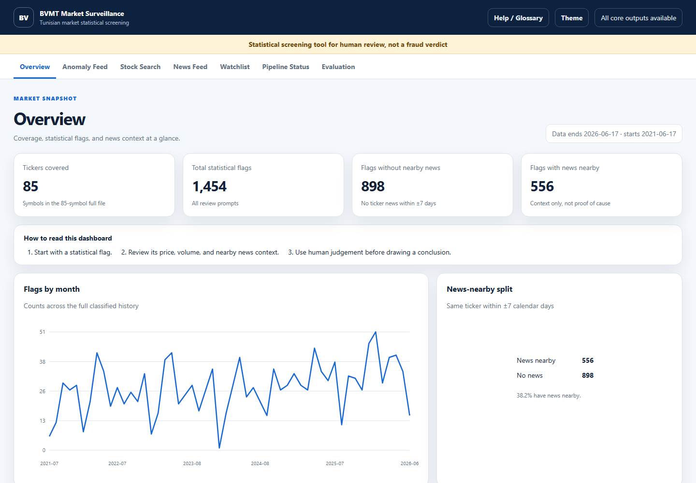
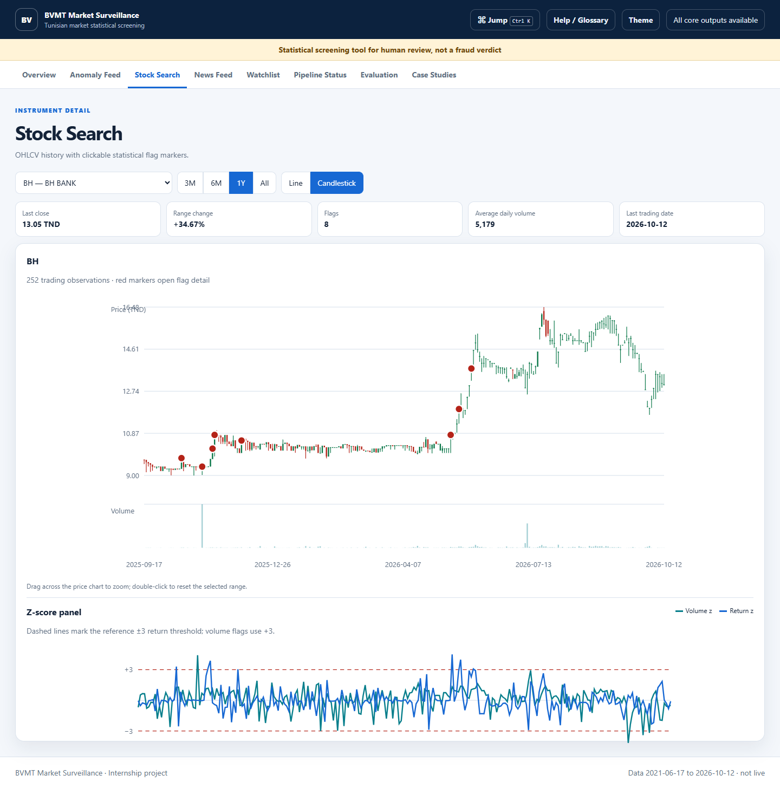
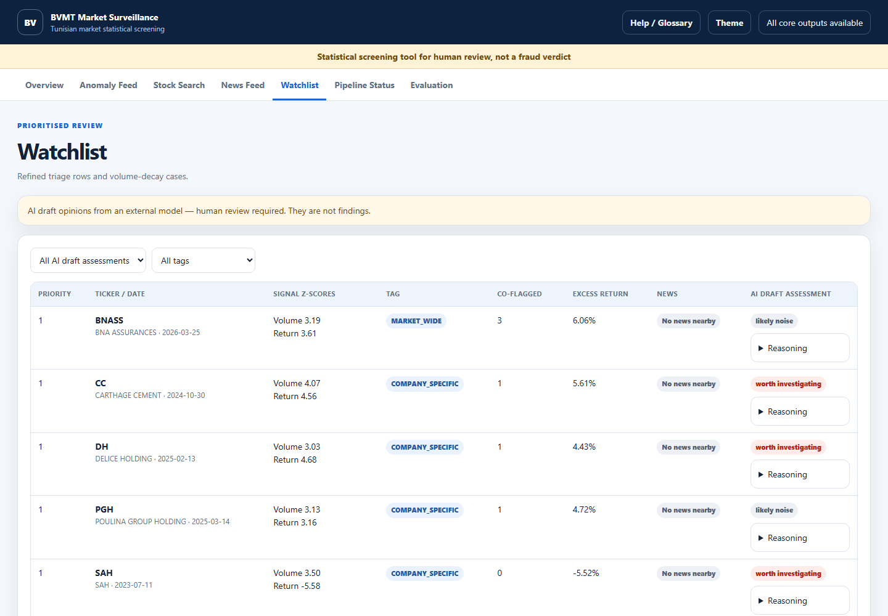

# BVMT Market Surveillance

A reproducible statistical screening project for the Bourse de Valeurs Mobilières de Tunis (BVMT). It identifies unusual price or volume activity, adds local news context, and produces a review queue for a human analyst.

> **Statistical screening tool for human review, not a fraud verdict.** This independent academic project is not affiliated with BVMT or CMF and is not investment or legal advice.

## What is included

- An 85-symbol delivered analysis dataset with 61,812 source observations covering 17 June 2021 to 17 June 2026.
- A transparent rolling z-score detector for volume and returns.
- News cross-reference, rule-based classification, and watchlist refinement.
- Optional Groq-assisted triage whose output is a draft opinion for human review.
- A source-audited, case-study-level evaluation with fixed event windows, simple baselines, sensitivity reporting, and a negative control.
- A seven-page, responsive Flask dashboard with native SVG charts and an offline pytest suite.

## Dashboard v2

- Overview with labelled monthly activity, top-ticker counts, news-context split, and recent flags.
- Full Anomaly Feed with server-side filters, sorting, pagination, CSV export, and contextual detail drawers.
- Stock Search with price and volume axes, OHLCV hover tooltips, range controls, and clickable flag markers.
- News Feed with ticker/category filters and links from matched headlines back to flag detail.
- Watchlist with 14 current refined cases and 15 volume-decay cases; older AI drafts are hidden when their source queue is stale.
- Help/glossary, keyboard-friendly drawers, loading/error states, responsive layouts, and an optional saved dark theme.





## Install

Python 3.10 or later is recommended.

```bash
python -m venv .venv
```

On Windows PowerShell:

```powershell
.\.venv\Scripts\Activate.ps1
python -m pip install -r requirements.txt
```

On macOS or Linux:

```bash
source .venv/bin/activate
python -m pip install -r requirements.txt
```

AI triage is optional. To enable it, copy `.env.example` to `.env`, set `GROQ_API_KEY`, and keep `GROQ_MODEL=openai/gpt-oss-120b`. Never commit `.env`.

## Run

Run all analysis steps from the existing local data:

```bash
python run_all.py
```

This default does not run a scraper or make AI calls. Use `--with-ai` only for a
deliberate Groq triage run. The `--with-scrape` option performs network collection
and should be used only when a deliberate data refresh is required. Evaluation,
baselines, sensitivity tables, the report summary, and a hash-based freshness
manifest are regenerated by the default analysis pipeline.

Start the dashboard:

```bash
python app.py
```

Then open `http://127.0.0.1:5000`.

The dashboard is read-only by default, binds to loopback, and does not expose a
pipeline trigger. If a controlled execution API is explicitly required, set
`BVMT_ENABLE_PIPELINE_API=true` and a strong `BVMT_PIPELINE_API_TOKEN`. Network
scraping additionally requires `BVMT_ENABLE_NETWORK_SCRAPE=true`; do not expose
this local development server directly to the internet.

Run the offline tests:

```bash
python -m pytest -q
```

## Pipeline

```text
existing price/news CSVs
        |
        v
rolling anomaly detector + decay detector
        |
        v
news/event cross-reference -> classification -> refined watchlist
        |
        v
optional Groq draft triage
        |
        +----> dashboard
        +----> case-study evaluation
```

The reference detector requires 60 valid prior observations and uses a z-score cutoff of 3.0. The current day is excluded from its own baseline. Volume uses `log(1 + volume)`, standard deviations have defensive floors, and returns across gaps longer than 10 days are excluded. Source OHLC values are retained; range violations are written to `bvmt_data/anomaly_data_quality.csv` for review.

## Repository structure

```text
app.py                       Flask API and dashboard server
run_all.py                   safe, analysis-first pipeline entry point
bvmt_data/                   protected raw CSVs plus the derived 85-symbol analysis file
data/evaluation/events.csv   audited evaluation events
src/detection/               transparent statistical detectors
src/validation/              context and watchlist stages
src/triage/                  optional Groq-assisted draft triage
src/evaluation/              metrics, baselines, and sensitivity tools
outputs/evaluation/          generated tables, figures, and summary
outputs/evaluation_60symbol/ archived earlier 60-symbol evaluation
templates/dashboard.html     semantic seven-page dashboard shell
static/dashboard.css         offline responsive design system
static/dashboard.js          API client, native SVG charts, filters, and drawers
tests/                       offline tests and minimal fixtures
docs/REPORT.md               full project report
docs/DEMO_SCRIPT.md          five-minute presentation guide
```

## Results summary

The evaluation window was fixed before calculation: 30 calendar days before through 5 days after an event, with a secondary 60-day lookback. The evaluation date is the earliest public suspension, court ruling, or first announcement in the stored evidence; original labels and later dates remain visible.

- 3 source-backed positive events; 2 have trading data in the primary window and 3 in the secondary window.
- Reference detector: 0 of 2 evaluable events in the primary window and 0 of 3 events in the secondary window.
- 947 flags, equal to 2.397 flags per observed ticker-year.
- 14 refined-watchlist rows. The prior 17-row Groq output belongs to the superseded queue and is not shown as current.
- Precision at 10, 20, and 50: 0 of 10, 0 of 20, and 0 of 50 flags near a labeled event.
- SOPAT negative control: 0 flags in the primary window.
- Volume-only and return-only baselines also match 0 of 2 primary-window events.
- No corrected reference flag matches an evaluable positive event in either fixed window.
- The reference does not beat the return-only baseline on recall or precision and produces 176 more flags.

These are case-study results, not a statistical performance estimate. See [outputs/evaluation/summary.md](outputs/evaluation/summary.md) and [docs/REPORT.md](docs/REPORT.md).

## Limitations

- Only 3 positive events have repository sources, and only 2 are evaluable in the primary window.
- TINV, UADH, TSI, CGF, and UBCI remain `SOURCE_NEEDED` and are excluded from headline metrics. CGF and TSI have no ticker files, are not in the dataset, and cannot be evaluated.
- Labels are incomplete, so the reported precision measure undercounts unknown relevant events.
- There is no independent test set; reference parameters were chosen before this evaluation, and the sensitivity grid is reporting only.
- Thin trading, missing news, delistings, and survivorship bias can affect results.
- AI output is a draft assessment for a human reviewer, never a verdict.
- The archived 60-symbol run used the superseded 20-observation warm-up and close clamping, so it is retained for provenance but is not directly comparable with the corrected reference.
- Precision ranks flags by the larger absolute volume or return z-score; 3 of the top 20 meet the documented bottom-quartile illiquidity definition.

## Documentation

- [Project report](docs/REPORT.md)
- [Demo script](docs/DEMO_SCRIPT.md)
- [Evaluation summary](outputs/evaluation/summary.md)
- [Full-universe coverage audit](outputs/evaluation/coverage_audit.md)
- [Engineering decisions](docs/DECISIONS.md)
- [Delivery status](docs/STATUS.md)

## License

See [LICENSE](LICENSE).
